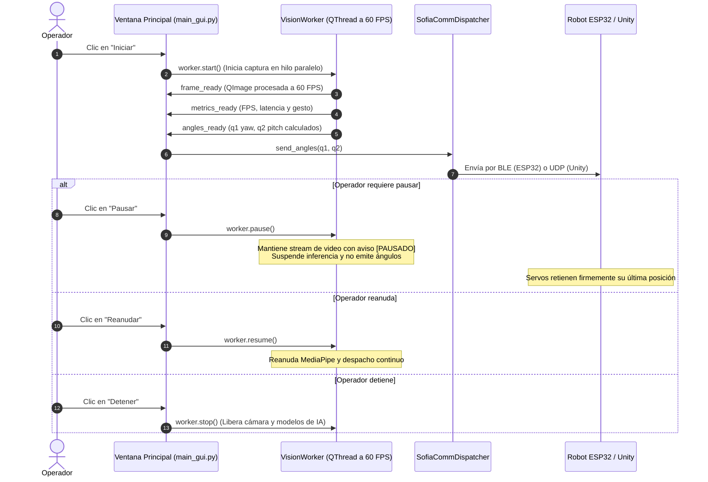

# 📚 Arquitectura Modular y Guía Operativa - Proyecto SOFÍA

Este documento describe la estructura del código en `code/`, la responsabilidad de cada módulo y los pasos detallados para instalar dependencias y ejecutar la estación de control (GUI en PySide6), así como los canales de comunicación inalámbrica Bluetooth (BLE) y simulación (UDP).

---

## 🧭 Mapa General de la Arquitectura

```text
IOT-SOFIA-2026/
├── code/
│   ├── requirements.txt          # Dependencias unificadas (Python 3.10 o 3.11)
│   ├── CODE.md                   # Esta guía técnica y operativa
│   │
│   ├── gui-control/              # 🖥️ ESTACIÓN DE CONTROL Y MONITOREO (PySide6)
│   │   ├── main_gui.py           # Ventana principal, layout visual y despacho de eventos
│   │   ├── vision_worker.py      # Hilo concurrente QThread para cámara a 60 FPS (start/pause/stop)
│   │   ├── styles.py             # Hoja de estilos QSS (Tema oscuro moderno)
│   │   ├── build_exe.spec        # Especificación de PyInstaller para compilar .exe
│   │   └── requirements.txt      # Dependencias específicas de la interfaz
│   │
│   ├── tracking-vision/          # 👁️ PROCESAMIENTO DE IMAGEN E IA (MediaPipe)
│   │   ├── detectors/            # Detectores de manos, postura y gestos
│   │   ├── gestures/             # Lógica cinemática de gestos y clasificador PPT
│   │   ├── utils/                # Filtro EMA de suavizado y dibujado de landmarks
│   │   ├── models/               # Redes neuronales de MediaPipe (.task)
│   │   └── GUIA_VISION_Y_POSTURAS.md # Manual cinemático y de filtrado
│   │
│   ├── communication/            # 🚀 ENLACE Y DESPACHO DE COMUNICACIONES
│   │   ├── dispatcher.py         # Enrutador inteligente (conmuta entre BLE y UDP)
│   │   ├── ble_sender.py         # Cliente BLE asíncrono multihilo para ESP32-C3
│   │   └── README.md             # Guía técnica del módulo de comunicaciones
│   │
│   └── firmware-mecatronica/     # ⚙️ FIRMWARE DE MICROCONTROLADORES
│       └── modulo_sofia.ino      # Firmware oficial para ESP32-C3 y PCA9685 (I2C)
│
├── docs/                         # 📄 DOCUMENTACIÓN TÉCNICA FORMAL
│   ├── ARQUITECTURA_Y_WIREFRAMES_GUI.md # Memoria de arquitectura y wireframes
│   ├── ESTANDAR_COMUNICACION_PC_ESP32.md # Estándar formal de tramas y protocolos
│   └── DOCS.md                   # Índice general de documentación
│
├── WEBOT SOFIA/                  # Simulación en Webots y scripts de prueba
└── unity-simulation/             # Cinemática en Unity 3D (C#)
```

---

## ⚙️ Requisitos Previos e Instalación del Entorno

> [!NOTE]
> **Versiones de Python probadas y certificadas:**  
> El sistema ha sido probado y verificado al 100% tanto en **Python 3.14** (versión de desarrollo con `mediapipe 0.10.35` en macOS Apple Silicon) como en **Python 3.11** (entorno estable de Homebrew y Windows).
> * Si tienes **Python 3.14** instalado, puedes crear el entorno directamente (`py -m venv venv` o `python3 -m venv venv`) y funcionará sin problemas.
> * Si en alguna máquina ajena o versión específica de Linux/Windows se presentara alguna incompatibilidad de paquetes, se recomienda usar **Python 3.11** como versión de máxima compatibilidad estándar.

### 📋 Dependencias Unificadas (`code/requirements.txt`)
En el proyecto existen archivos locales en subcarpetas (`gui-control/requirements.txt` y `tracking-vision/requirements.txt`). Para evitar confusiones, el archivo **[`code/requirements.txt`](code/requirements.txt)** consolida **todas** las dependencias requeridas por el sistema en una sola lista oficial:
* `mediapipe>=0.10.0,<1.0.0` (Inferencia de puntos corporales y manos 3D)
* `opencv-python>=4.8.0` (Captura de cámara a 60 FPS y procesado de video)
* `PySide6>=6.5.0` (Interfaz gráfica oficial de Qt)
* `bleak>=0.21.0` (Comunicación inalámbrica Bluetooth BLE con el ESP32)
* `numpy>=1.24.0` (Cálculo de matrices, ángulos articulares y filtrado EMA)

---

### 🍎 Opción A: Configuración en macOS / Linux

1. **Abrir la terminal** y ubicarse dentro de la carpeta **`code/`** (ya sea tras descomprimir el ZIP o dentro del repositorio clonado):
   ```bash
   cd code
   ```

2. **Crear el entorno virtual dentro de `code/`:**
   ```bash
   # Opción 1 (Directa con tu Python instalado, ej. Python 3.14):
   py -m venv venv
   # o:
   python3 -m venv venv
   
   # Opción 2 (Alternativa forzando Python 3.11 si lo prefieres):
   python3.11 -m venv venv
   # (o con Homebrew: /opt/homebrew/bin/python3.11 -m venv venv)
   ```

3. **Activar el entorno virtual:**
   ```bash
   source venv/bin/activate
   ```
   *Comprueba la versión activa ejecutando `python --version`; debe responder `Python 3.11.x`.*

4. **Actualizar pip e instalar todas las dependencias:**
   ```bash
   pip install --upgrade pip
   pip install -r requirements.txt
   ```

5. **Lanzar la interfaz gráfica:**
   ```bash
   python gui-control/main_gui.py
   ```

---

### 🪟 Opción B: Configuración en Windows (PowerShell o CMD)

1. **Abrir PowerShell** y ubicarse dentro de la carpeta **`code`**:
   ```powershell
   cd code
   ```

2. **Crear el entorno virtual forzando Python 3.11:**
   En Windows tienes varias opciones según cómo tengas instalado Python:
   ```powershell
   # Método 1 (Recomendado con el lanzador oficial de Windows):
   py -3.11 -m venv venv

   # Método 2 (Si Python 3.11 es tu versión predeterminada en PATH):
   python -m venv venv

   # Método 3 (Invocando la ruta estándar de instalación en Windows):
   & "$env:LOCALAPPDATA\Programs\Python\Python311\python.exe" -m venv venv

   # Método 4 (Si aún no tienes Python 3.11 en Windows, instálalo en segundos con winget):
   winget install Python.Python.3.11
   py -3.11 -m venv venv
   ```

3. **Activar el entorno virtual:**
   * En **PowerShell**:
     ```powershell
     .\venv\Scripts\Activate.ps1
     ```
     *(Si PowerShell restringe scripts, permite la sesión con: `Set-ExecutionPolicy -Scope Process -ExecutionPolicy Bypass`).*
   * En **CMD**:
     ```cmd
     venv\Scripts\activate.bat
     ```
   *Comprueba la versión activa con `python --version`; debe responder `Python 3.11.x`.*

4. **Actualizar pip e instalar requerimientos:**
   ```powershell
   python -m pip install --upgrade pip
   pip install -r requirements.txt
   ```

5. **Lanzar la estación de control:**
   ```powershell
   python gui-control/main_gui.py
   ```

---

## 🔄 ¿Cómo Funciona la Interfaz Gráfica? (Flujo Operativo)

La GUI implementa un modelo multihilo estricto basado en **PySide6**:



---

## 🎛️ Guía de Uso de la Pantalla de Control

Una vez abierta la ventana de 1200 × 760 píxeles, dispones de los siguientes controles:

1. **Destino de Comunicación (Panel Superior Derecho):**
   * **Simulación (Unity / UDP):** Seleccionado por defecto. Envía paquetes `q1,q2` a `127.0.0.1:5005` para validar movimientos en el gemelo digital sin requerir hardware físico.
   * **Robot Físico (ESP32 / BLE):** Cambia el destino al robot real. Introduce la MAC del ESP32 (por defecto `70:AF:09:15:23:42` en Windows/Linux o el UUID asignado por CoreBluetooth en macOS) y presiona **"Conectar BLE"**. Al conectar, el botón pasa a color verde *"Desconectar"*.

2. **Ciclo de Vida de la Detección:**
   * **Botón "Iniciar":** Abre la cámara web e inicia la inferencia 3D en el hilo secundario.
   * **Botón "Pausar / Reanudar":** Permite detener momentáneamente el seguimiento sin apagar la cámara. La pantalla muestra el aviso `[ DETECCION PAUSADA ]` y los servomotores se quedan inmóviles en su último ángulo. Al pulsar *"Reanudar"*, el seguimiento continúa al instante.
   * **Botón "Detener":** Cierra la captura de video y libera los recursos de la red neuronal.

3. **Modos de Operación:**
   * **Seguimiento Automático 3D:** Los servomotores siguen de forma fluida el centroide de tu mano o cabeza dentro de los ángulos permitidos.
   * **Control Manual:** Permite mover directamente los sliders $q_1$ (horizontal) y $q_2$ (vertical). Los sliders están limitados por software al rango de seguridad mecánica **[$60^\circ, 120^\circ$]** para proteger los actuadores MG90S.
   * **Calibración (Home):** Centra ambos ejes a $90^\circ, 90^\circ$.
   * **Reposo:** Coloca la articulación vertical en descanso a $60^\circ$.

4. **Reconocimiento de Gestos Coreográficos:**
   * Al hacer el gesto de **"Hola" (Saludo)** o **"Corazón"** frente a la cámara, la interfaz detecta la intención y despacha la rutina coreográfica almacenada en el ESP32, suspendiendo temporalmente el seguimiento mediante un temporizador `QTimer` para evitar interferencias cinemáticas.

5. **Terminal de Eventos:**
   * Consola inferior en color verde esmeralda que registra en tiempo real los eventos de conexión, comandos transmitidos, ángulos y estados del sistema.

---

## 📦 Compilación a Ejecutable Autónomo para Windows (.exe)

Si se requiere entregar una versión autocontenida que no requiera instalar Python ni bibliotecas en la máquina destino:

```powershell
cd code/gui-control
pyinstaller build_exe.spec
```
El archivo ejecutable compilado se generará dentro de `code/gui-control/dist/SOFIA_Control_Station.exe`.

---

## 🔬 Ejecución de Scripts Auxiliares por Consola

Para pruebas rápidas de laboratorio sin abrir la interfaz gráfica completa:
* **Control manual de servomotores por terminal BLE:**
  ```bash
  python "WEBOT SOFIA/controlar_sofia_ble.py"
  ```
* **Tracking de 9 cuadrantes en consola:**
  ```bash
  python code/tracking-vision/test_ble_pipe_v2.py
  ```