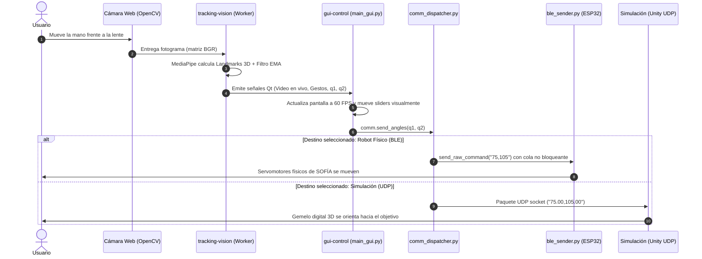

# 📚 Arquitectura Modular y Guía Operativa - Proyecto SOFÍA

Este documento describe la estructura del código en `code/`, qué hace cada archivo y cómo operar el sistema: desde la visión por computadora hasta la conexión inalámbrica Bluetooth (BLE) con el robot físico y la simulación en Unity/Webots.

---

## 🧭 Mapa General de la Arquitectura

```text
IOT-SOFIA-2026/
├── code/
│   ├── tracking-vision/          # Procesamiento de imagen e IA (MediaPipe)
│   │   ├── detectors/            # Clases detectoras (manos, postura, gestos)
│   │   ├── gestures/             # Lógica matemática de cada gesto y juego PPT
│   │   ├── utils/                # Filtro EMA de suavizado y dibujo de esqueletos
│   │   ├── models/               # Redes neuronales de MediaPipe (.task)
│   │   └── GUIA_VISION_Y_POSTURAS.md # Manual universitario de cinemática y filtrado
│   │
│   ├── communication/            # 🚀 CANALES DE ENLACE Y TELEMETRÍA (FÍSICO & VIRTUAL)
│   │   ├── dispatcher.py         # Enrutador inteligente (Conmuta entre BLE y UDP)
│   │   ├── ble_sender.py         # Driver Bluetooth Low Energy para ESP32-C3
│   │   └── README.md             # Guía de uso rápido del módulo de comunicaciones
│   │
│   ├── gui-control/              # Estación de control de escritorio (PySide6)
│   │   ├── main_gui.py           # Dashboard visual unificado (Vista/UI limpia)
│   │   ├── vision_worker.py      # Hilo concurrente QThread para la cámara a 60 FPS
│   │   ├── styles.py             # Estilos modo oscuro moderno
│   │   ├── build_exe.spec        # Empaquetador PyInstaller para generar el .exe
│   │   └── requirements.txt      # Dependencias completas (PySide6, OpenCV, MediaPipe, Bleak)
│   │
│   └── firmware-mecatronica/     # Firmware de microcontroladores y drivers
│
├── WEBOT SOFIA/                  # Simulación en Webots y scripts originales de prueba BLE
│   ├── cad/                      # Piezas mecánicas 3D (Base, Ejes X/Y, Hexágono)
│   ├── controlar_sofia_ble.py    # Control manual por terminal
│   └── webots/worlds/            # Mundo virtual de Webots (.wbt)
│
└── unity-simulation/             # Simulación y cinemática en Unity 3D (C#)
```

---

## 🔄 ¿Cómo Funciona Todo Entrelazado? (El Flujo de Datos)

Para entender cómo se conectan los 4 pilares del sistema, imagina una cadena de relevos que ocurre en milisegundos en cada fotograma:



### 🧩 Los 4 Componentes Explicados a Grandes Rasgos:

| Componente | Rol en el Sistema | ¿Qué hace exactamente? |
| :--- | :--- | :--- |
| **1. `tracking-vision/`**<br>*(El Ojo y Cerebro)* | Captura y Percepción | Lee la cámara, corre las redes de MediaPipe para extraer los 21 puntos de la mano y 33 del cuerpo, filtra el temblor con el suavizador EMA y calcula matemáticamente los ángulos $q_1, q_2$ y gestos (puño, tijera, saludo, PPT). |
| **2. `gui-control/main_gui.py`**<br>*(La Cara y Centro de Mando)* | Interfaz de Usuario (UI/UX) | Muestra el video a 60 FPS sin trabarse, ofrece controles de detección (inicio, pausa/reanudación y paro seguro), sliders para control manual, selector de modos (automático, reposo, calibración) y la consola de telemetría. **No procesa video ni abre sockets directamente**, solo escucha y delega. |
| **3. `comm_dispatcher.py`**<br>*(El Cartero / Enrutador)* | Despacho de Comunicaciones | Es el intermediario inteligente. Recibe los ángulos $(q_1, q_2)$, aplica los límites de seguridad física ($60^\circ$ a $120^\circ$) y decide a dónde mandarlos según el botón seleccionado en la pantalla: si a la simulación o al robot real. |
| **4. `ble_sender.py`**<br>*(El Puente Inalámbrico Físico)* | Driver de Hardware BLE | Se conecta por Bluetooth Low Energy al ESP32-C3 del robot físico. Tiene una cola interna (`queue.Queue`) para enviar los comandos de forma asíncrona sin saturar el radio ni detener la interfaz. |

---

### 📋 Datos Técnicos de Enlace del Robot Físico:
- **Microcontrolador:** ESP32-C3
- **Dirección MAC BLE:** `70:AF:09:15:23:42`
- **Servicio UART UUID:** `6e400001-b5a3-f393-e0a9-e50e24dcca9e`
- **Característica Write UUID:** `6e400002-b5a3-f393-e0a9-e50e24dcca9e`
- **Rango seguro de servomotores:** $60^\circ$ a $120^\circ$ (Posición Neutra/Home: $90^\circ, 90^\circ$).

---

### 🖥️ Método 1: La Interfaz Gráfica Integrada (Recomendado)
Todo unificado en una sola ventana: video fluido, gestos, control manual y botón para conectar por Bluetooth al robot físico o por UDP a Unity.

1. **Instalar dependencias:**
   ```bash
   pip install -r code/gui-control/requirements.txt
   ```
2. **Ejecutar la GUI:**
   ```bash
   python code/gui-control/main_gui.py
   ```
3. **¿Cómo usarla?**
   - **Destino de Control:** Selecciona si quieres enviar las órdenes a:
     - 🔘 **Robot Físico (BLE):** Pulsa el botón *"Conectar BLE"*; se enlazará al ESP32 sin bloquear la pantalla.
     - 🔘 **Simulación Unity (UDP):** Transmite paquetes en tiempo real al puerto `5005`.
   - **Iniciar Cámara:** Pulsa *"▶ Iniciar Cámara"*. El video mostrará tus manos y los gestos detectados.
   - **Modo Automático:** Mueve tu mano y el robot físico o la simulación te seguirán de forma fluida.
   - **Modo Manual:** Usa los sliders de $q_1$ y $q_2$ para mover los servomotores milimétricamente.
   - **Calibración y Reposo:** Botones directos para llevar el robot al centro ($90^\circ, 90^\circ$) o a postura de descanso para proteger los actuadores.

---

### 📦 Método 2: Compilar a un `.exe` Autónomo para Windows
Si necesitas entregar el software para que corra en cualquier computadora sin tener Python instalado:

```bash
cd code/gui-control
pyinstaller build_exe.spec
```
El archivo ejecutable resultante estará en `code/gui-control/dist/SOFIA_Control_Station.exe`, incluyendo internamente los modelos de MediaPipe y el soporte Bluetooth de Bleak.

---

### 🔬 Método 3: Ejecución de Scripts Ligeros por Consola
Si estás en una prueba de laboratorio y solo quieres correr terminales rápidas:
- **Probar el robot físico por consola (sin cámara):**
  ```bash
  python "WEBOT SOFIA/controlar_sofia_ble.py"
  ```
- **Tracking de 9 cuadrantes en consola con BLE:**
  ```bash
  python code/tracking-vision/test_ble_pipe_v2.py
  ```