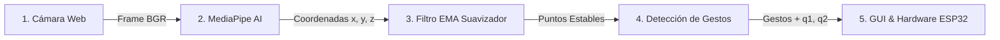

# 📘 Guía Universitaria: Visión Artificial, Posturas y Filtrado en SOFÍA

Este documento explica de forma intuitiva, paso a paso y con fundamentos de ingeniería, cómo funciona el sistema de visión por computadora de SOFÍA. Está pensado para que cualquier estudiante, evaluador o nuevo integrante del equipo entienda qué ocurre desde que la cámara captura un rayo de luz hasta que el robot interpreta un gesto.

---

## 📑 Tabla de Contenidos
1. [El Flujo General de la Visión](#1-el-flujo-general-de-la-visión)
2. [¿Qué son los Landmarks? (Puntos Clave)](#2-qué-son-los-landmarks-puntos-clave)
3. [El Problema del Temblor y el Filtro EMA (Suavizado)](#3-el-problema-del-temblor-y-el-filtro-ema-suavizado)
4. [¿Cómo se detectan las Posturas y Gestos?](#4-cómo-se-detectan-las-posturas-y-gestos)
   - [Matemática de los Dedos (Estirado vs Doblado)](#41-matemática-de-los-dedos-estirado-vs-doblado)
   - [Gestos Estáticos: Roca, Papel, Tijera, Corazón](#42-gestos-estáticos-roca-papel-tijera-corazón)
   - [Gestos Dinámicos: Saludo, Swipe y Conteo PPT](#43-gestos-dinámicos-saludo-swipe-y-conteo-ppt)
5. [Cálculo de Orientación Articular ($q_1, q_2$)](#5-cálculo-de-orientación-articular-q_1-q_2)
6. [Resumen Rápido para Exposiciones](#6-resumen-rápido-para-exposiciones)

---

## 1. El Flujo General de la Visión

En cada fotograma (a 30–60 cuadros por segundo), el sistema sigue una cadena de 5 pasos consecutivos:



1. **Captura:** OpenCV lee el cuadro en formato BGR y lo convierte a RGB.
2. **Inferencia de Red Neuronal:** Google MediaPipe encuentra dónde está la mano y el cuerpo.
3. **Filtro de Ruido (EMA):** Elimina el parpadeo y la vibración de los puntos.
4. **Reglas de Decisión:** Compara distancias y ángulos para saber si es un puño, tijera, saludo, etc.
5. **Transmisión:** Los ángulos resultantes ($q_1, q_2$) se envían por UDP a Unity o por BLE al ESP32.

---

## 2. ¿Qué son los Landmarks? (Puntos Clave)

MediaPipe no analiza "píxeles de colores sueltos"; busca **nodos articulares** y devuelve sus coordenadas tridimensionales normalizadas entre $0.0$ y $1.0$:

- **$x$:** Posición horizontal en pantalla ($0.0$ izquierda, $1.0$ derecha).
- **$y$:** Posición vertical en pantalla ($0.0$ arriba, $1.0$ abajo).
- **$z$:** Profundidad estimada relativa respecto a la cámara.

### Los 21 Puntos de la Mano:
```text
           (8) Dedo Índice
    (12)      \   (4) Pulgar
  Medio \      \  /
         \      (3)
         (11)   (2)
   (16)   |      |
 Anular\  (10)  (1)
        \  |    /
   (20)  (9) --+
 Meñique  |
    \    (13)
    (19)  |
     |   (17)
    (18) /
      \ /
      (0) Muñeca (Base de referencia)
```
* **Puntas de los dedos:** `[4: Pulgar, 8: Índice, 12: Medio, 16: Anular, 20: Meñique]`
* **Nudillos / Articulaciones medias (PIP):** `[2, 6, 10, 14, 18]`
* **Muñeca:** Landmark `0` (origen para medir distancias relativas).

---

## 3. El Problema del Temblor y el Filtro EMA (Suavizado)

### ❓ ¿Por qué tiemblan los puntos si la mano está quieta?
La cámara tiene ruido de sensor, cambios de luz y compresión. La red neuronal calcula coordenadas ligeramente distintas en cada cuadro (por ejemplo: $x = 0.501 \to 0.509 \to 0.495$). 
Si enviamos esas coordenadas directas a un servomotor, el servo **vibra, hace ruido y se sobrecalienta**.

### 💡 La Solución Matemática: Media Móvil Exponencial (EMA)
En lugar de aceptar el punto nuevo de golpe, el filtro en [`utils/smoother.py`](utils/smoother.py) hace un promedio ponderado:

$$P_{\text{filtrado}} = \alpha \cdot P_{\text{nuevo}} + (1 - \alpha) \cdot P_{\text{anterior}}$$

Donde $\alpha$ (alpha) es el **factor de suavizado** (en SOFÍA usamos $\alpha = 0.35$):
* **Si $\alpha = 1.0$:** Sin filtro (reacciona instantáneo, pero tiembla mucho).
* **Si $\alpha = 0.05$:** Ultra suave, pero con retraso (efecto "cámara lenta").
* **$\alpha = 0.35$:** El equilibrio perfecto entre respuesta ágil e inmunidad a vibraciones.

---

## 4. ¿Cómo se detectan las Posturas y Gestos?

No usamos redes neuronales gigantes para cada gesto. Usamos **geometría analítica 3D** sobre los landmarks, lo cual corre a cientos de FPS consumiendo casi 0% de CPU.

### 4.1 Matemática de los Dedos (Estirado vs Doblado)
Para saber si un dedo está estirado o cerrado (ver [`gestures/finger_utils.py`](gestures/finger_utils.py)):

1. Medimos la distancia 3D euclidiana:
   $$d = \sqrt{(x_2 - x_1)^2 + (y_2 - y_1)^2 + (z_2 - z_1)^2}$$
2. Comparamos la distancia de la **punta** a la muñeca ($d_{\text{punta}}$) contra la del **nudillo medio** a la muñeca ($d_{\text{pip}}$):
   - **Dedo estirado:** $d_{\text{punta}} > 1.15 \cdot d_{\text{pip}}$ (la punta se alejó).
   - **Dedo doblado:** $d_{\text{punta}} \le 1.05 \cdot d_{\text{pip}}$ (la punta se encogió hacia la palma).

---

### 4.2 Gestos Estáticos

| Gesto | Archivo | Condición Geométrica |
| :--- | :--- | :--- |
| **Piedra (Roca)** | [`gestures/rock.py`](gestures/rock.py) | Los 4 dedos doblados (`8, 12, 16, 20`) y todas las puntas a menos de $1.6 \times$ del tamaño de la palma. |
| **Papel** | [`gestures/paper.py`](gestures/paper.py) | Los 5 dedos (incluyendo pulgar) extendidos simultáneamente. |
| **Tijera** | [`gestures/scissors.py`](gestures/scissors.py) | Índice (`8`) y Medio (`12`) extendidos; Anular (`16`) y Meñique (`20`) doblados. |
| **Corazón** | [`gestures/heart.py`](gestures/heart.py) | Ambas manos presentes, puntas de pulgares muy cerca entre sí y puntas de índices también muy juntas formando el arco superior. |

---

### 4.3 Gestos Dinámicos (Con Tiempo y Movimiento)

A diferencia de una foto fija, estos gestos evalúan la variación en el tiempo ($\Delta t$):

#### 👋 Saludo ([`gestures/wave.py`](gestures/wave.py))
- Detecta mano abierta a la altura de la cabeza.
- Registra la velocidad horizontal ($v_x$). Si la dirección cambia alternadamente (izquierda $\to$ derecha $\to$ izquierda) al menos 3 veces en menos de 1.5 segundos, activa `HOLA! SALUDO`.

#### 💨 Barrido o Swipe ([`gestures/swipe.py`](gestures/swipe.py))
- Si el centro de la palma se desplaza rápidamente más de $0.25$ unidades en el eje X en menos de 300 ms, detecta `SWIPE DERECHA` o `SWIPE IZQUIERDA`.

#### 🥊 Conteo de Intención PPT ([`gestures/rps_intent.py`](gestures/rps_intent.py))
- Implementa una **Máquina de Estados Finitos (FSM)**:
  1. Detecta una mano plana como base (Palma abierta) y la otra en Puño.
  2. Evalúa ciclos de distancia vertical: Puño arriba $\to$ Puño toca palma ($1/3 \to 2/3 \to 3/3$).
  3. Al tercer toque confirma: `¡LISTO PARA JUGAR PPT!`.

---

## 5. Cálculo de Orientación Articular ($q_1, q_2$)

Para que el robot apunte físicamente hacia donde está el usuario:

- **Eje Horizontal (Yaw - $q_1$):**
  $$q_1 = (x_{\text{muñeca}} - 0.5) \times 180^\circ$$
  - Si la mano está en el centro ($x = 0.5$), $q_1 = 0^\circ$.
  - Si la mano se va a la izquierda ($x = 0.0$), $q_1 = -90^\circ$.
  - Si la mano se va a la derecha ($x = 1.0$), $q_1 = +90^\circ$.

- **Eje Vertical (Pitch - $q_2$):**
  $$q_2 = (0.5 - y_{\text{muñeca}}) \times 180^\circ$$
  - Si la mano sube ($y < 0.5$), $q_2 > 0^\circ$ (el robot mira hacia arriba).
  - Si la mano baja ($y > 0.5$), $q_2 < 0^\circ$ (el robot mira hacia abajo).

---

## 6. Resumen Rápido para Exposiciones

Si un profesor o jurado te pregunta:
1. **"¿Cómo reconocen las señas?"**
   > *"No usamos clasificación de imágenes por píxel que consuma GPU pesada; MediaPipe extrae la cinemática de los 21 landmarks 3D y nuestros algoritmos geométricos determinan la postura evaluando distancias euclidianas relativas entre puntas y nudillos en tiempo real."*

2. **"¿Cómo evitan que los servomotores vibren?"**
   > *"Implementamos un filtro de Media Móvil Exponencial (EMA) con $\alpha = 0.35$ que amortigua el ruido de inferencia de la cámara sin introducir latencia perceptible para el usuario."*

3. **"¿Por qué la GUI no se traba cuando corre la visión?"**
   > *"Separamos la arquitectura en dos hilos: un worker en `QThread` que realiza el procesamiento matricial y un hilo principal de `PySide6` que renderiza la interfaz a 60 FPS comunicados mediante señales seguras."*
