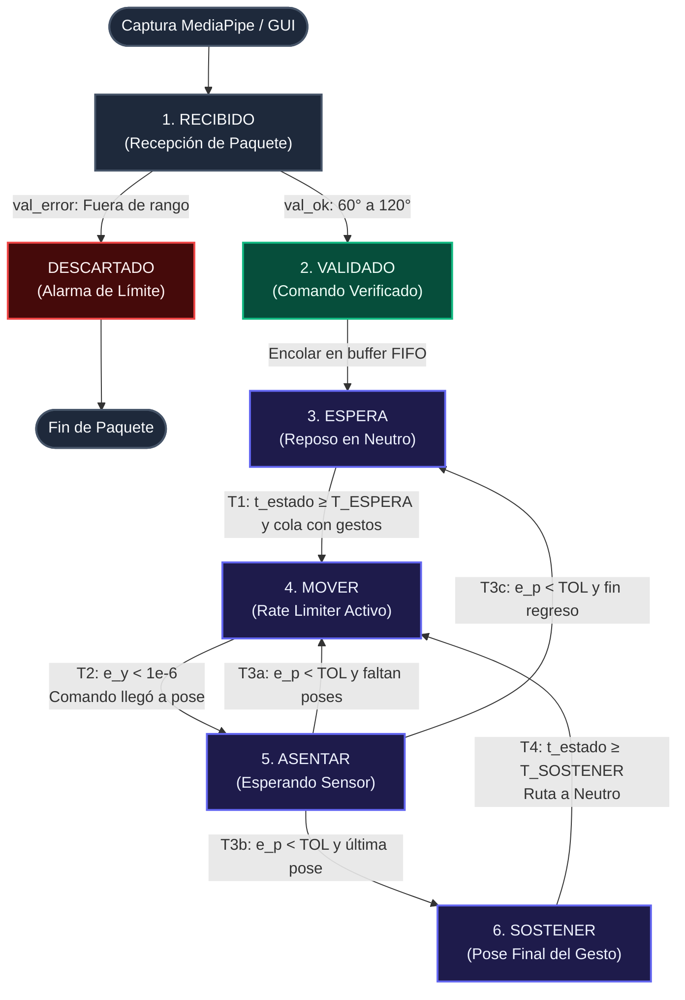

# 🤖 Máquina de Estados (State Machine) - SOFÍA 2026
**Control Cinemático, Ciclo de Vida de Comandos y Ejecución de Gestos**

---

## 1. Diagrama de Nodos y Conexiones

> [!TIP]
> Puedes abrir directamente [**`state_machine.html`**](file:///Users/bernardoorozco/Documents/GitHub/IOT-SOFIA-2026/state_machine.html) en tu navegador para ver el diagrama gráfico interactivo con colores y zoom.

### 1.1 Diagrama Visual Directo (ASCII Art)
```text
+-------------------------------------------------------------+
|                  Captura MediaPipe / GUI                    |
+-------------------------------------------------------------+
                              │
                              ▼
                  ┌───────────────────────┐
                  │      1. RECIBIDO      │
                  └───────────────────────┘
                              │
              ┌───────────────┴───────────────┐
   [val_ok]   │                               │   [val_error]
   (60°-120°) │                               │   (Fuera de rango)
              ▼                               ▼
  ┌───────────────────────┐       ┌───────────────────────┐
  │      2. VALIDADO      │       │      DESCARTADO       │
  └───────────────────────┘       └───────────────────────┘
              │                               │
     (Encolar en FIFO)                        ▼
              │                         [Fin de Paquete]
              ▼
  ┌───────────────────────────────────────────────────────┐
  │              3. ESPERA (Reposo / Neutro)              │◄────────────────┐
  └───────────────────────────────────────────────────────┘                 │
              │                                                             │
              │ T1: t_estado >= T_ESPERA  &&  len(cola) > 0                 │
              ▼                                                             │
  ┌───────────────────────────────────────────────────────┐                 │
  │             4. MOVER (Rate Limiter Activo)            │◄──────────┐     │
  │           y1 += D_MAX   |   y2 += D_MAX               │           │     │
  └───────────────────────────────────────────────────────┘           │     │
              │                                                       │     │
              │ T2: e_y < 1e-6 (Comando llegó a la pose)              │     │
              ▼                                                       │     │
  ┌───────────────────────────────────────────────────────┐           │     │
  │         5. ASENTAR (Confirmación de Sensor)           │           │     │
  └───────────────────────────────────────────────────────┘           │     │
     │                        │                                       │     │
     │ T3a: e_p < TOL         │ T3b: e_p < TOL                        │     │
     │ (Faltan poses)         │ (Última pose de la ruta)              │     │
     │                        ▼                                       │     │
     │            ┌───────────────────────┐                           │     │
     │            │      6. SOSTENER      │                           │     │
     │            └───────────────────────┘                           │     │
     │                        │                                       │     │
     │                        │ T4: t_estado >= T_SOSTENER            │     │
     │                        │ (Cargar ruta a Neutro)                │     │
     │                        └───────────────────────────────────────┤     │
     │                                                                │     │
     └────────────────────────────────────────────────────────────────┘     │
     │                                                                      │
     │ T3c: e_p < TOL (Retorno a neutro completado)                         │
     └──────────────────────────────────────────────────────────────────────┘
```

### 1.2 Diagrama Mermaid (Para Renderizadores Web)


---

## 2. Tabla Maestra de Transiciones de Estado

| Nodo Origen | Evento / Señal | Condición de Guarda | Acción Ejecutada | Nodo Destino |
| :--- | :--- | :--- | :--- | :--- |
| **`RECIBIDO`** | Paquete entrante | Comando válido o ángulos en rango seguro | Parsear y registrar en telemetría | **`VALIDADO`** |
| **`RECIBIDO`** | Paquete entrante | Ángulo fuera de rango o sintaxis rota | Emitir alarma y purgar paquete | **`DESCARTADO`** |
| **`VALIDADO`** | Inserción en cola | Conexión activa con el robot | Agregar comando al final de la cola FIFO | **`ESPERA`** |
| **`ESPERA`** | Ciclo de control $\Delta t$ | Tiempo de espera cumplido y cola no vacía | Extraer gesto, cargar lista de poses y fijar meta | **`MOVER`** |
| **`ESPERA`** | Ciclo de control $\Delta t$ | Tiempo de espera en curso o cola vacía | Mantener postura neutra actual | **`ESPERA`** |
| **`MOVER`** | Ciclo de control $\Delta t$ | Error de comando aún pendiente ($e_y \ge 10^{-6}$) | Aplicar Rate Limiter a las articulaciones $q_1, q_2$ | **`MOVER`** |
| **`MOVER`** | Ciclo de control $\Delta t$ | Comando alcanzó la pose ($e_y < 10^{-6}$) | Fijar comando exacto en la pose y registrar tiempo | **`ASENTAR`** |
| **`ASENTAR`** | Muestreo de sensores | Sensor llegó ($e_p < TOL$) y faltan poses en ruta | Quitar pose actual y fijar siguiente objetivo | **`MOVER`** |
| **`ASENTAR`** | Muestreo de sensores | Sensor llegó ($e_p < TOL$) y era la última pose | Quitar pose e iniciar temporizador de sostenimiento | **`SOSTENER`** |
| **`ASENTAR`** | Muestreo de sensores | Sensor llegó ($e_p < TOL$) y completó retorno neutro | Limpiar gesto activo y liberar control para tracking | **`ESPERA`** |
| **`ASENTAR`** | Muestreo de sensores | Servomotor físico aún viajando ($e_p \ge TOL$) | Esperar convergencia mecánica del hardware | **`ASENTAR`** |
| **`SOSTENER`** | Ciclo de control $\Delta t$ | Tiempo de sostenimiento cumplido | Cargar pose neutra y preparar retorno suave | **`MOVER`** |
| **`SOSTENER`** | Ciclo de control $\Delta t$ | Tiempo de sostenimiento en curso | Mantener robot fijo en la pose expresiva | **`SOSTENER`** |

---

## 3. Modelo Matemático y Formulación Cinemática

### 3.1 Rate Limiter Dinámico (Interpolación en `MOVER`)

Para evitar movimientos bruscos, picos de corriente y desgaste mecánico en los servomotores, el avance por cada ciclo temporal está acotado por un diferencial máximo $D_{MAX}$:

$$D_{MAX} = V_{MAX} \cdot \Delta t$$

Donde:
* $V_{MAX} = 1.5 \text{ rad/s}$ (Velocidad máxima angular configurada).
* $\Delta t = 0.032 \text{ s}$ (Paso de integración temporal a $\approx 30 \text{ Hz}$).
* $D_{MAX} \approx 0.048 \text{ rad}$ por paso temporal.

La actualización articular de cada motor se rige por:

$$y_1(k) = y_1(k-1) + \text{sat}\Big(r_1 - y_1(k-1), \ D_{MAX}\Big)$$

$$y_2(k) = y_2(k-1) + \text{sat}\Big(r_2 - y_2(k-1), \ D_{MAX}\Big)$$

Con la función de saturación simétrica:

$$\text{sat}(u, \ D_{MAX}) = \begin{cases} 
+D_{MAX} & \text{si } u > D_{MAX} \\ 
u & \text{si } -D_{MAX} \le u \le D_{MAX} \\ 
-D_{MAX} & \text{si } u < -D_{MAX} 
\end{cases}$$

---

### 3.2 Criterios de Convergencia y Transición

#### A. Error de Comando Numérico ($e_y$)
Indica si el generador de trayectoria ya alcanzó el objetivo matemático:

$$e_y = \max\Big(|r_1 - y_1|, \ |r_2 - y_2|\Big)$$

$$\text{Condición de transición a ASENTAR: } \quad e_y < 10^{-6} \text{ rad}$$

#### B. Error Físico de Posición Articular ($e_p$)
Indica si el hardware real (leído por sensor o encoder) ya llegó dentro de la ventana de tolerancia mecánica:

$$e_p = \max\Big(|r_1 - p_1|, \ |r_2 - p_2|\Big)$$

$$\text{Condición de confirmación en ASENTAR: } \quad e_p < TOL$$

* En simulación (Webots): $TOL = 0.01 \text{ rad} \approx 0.57^\circ$.
* En hardware real (ESP32 con servos PCA9685): $TOL \approx 2.0^\circ$.

---

### 3.3 Temporizadores de Estados

* **Tiempo en Reposo:**
$$T_{ESPERA} = 2.0 \text{ s}$$
Garantiza estabilidad entre secuencias consecutivas de movimiento.

* **Tiempo de Sostenimiento:**
$$T_{SOSTENER} = 1.0 \text{ s}$$
Mantiene fija la pose final para que el gesto sea claramente perceptible por las personas antes de regresar a neutro.

---

## 4. Catálogo de Gestos del Proyecto SOFÍA

| Nombre | Origen | Poses $(q_1, q_2)$ en Radianes | Poses $(q_1, q_2)$ en Grados ESP32 | Descripción |
| :--- | :--- | :--- | :--- | :--- |
| **`neutro`** | Base / Home | `[(0.0, 0.0)]` | `[(90°, 90°)]` | Centro geométrico y postura de descanso. |
| **`saludo`** | `wave.py` | `[(0.0, -0.52), (0.0, 0.52), (0.0, -0.52), (0.0, 0.52)]` | `[(90°, 60°), (90°, 120°), (90°, 60°), (90°, 120°)]` | 3 oscilaciones verticales de bienvenida. |
| **`corazon`** | `heart.py` | `[(0.0, 0.52), (0.52, 0.0), (0.0, -0.52), (-0.52, 0.0)]` | `[(90°, 120°), (120°, 90°), (90°, 60°), (60°, 90°)]` | Trayectoria orbital cerrada por los 4 cuadrantes. |
| **`si`** | Base | `[(0.0, 0.45), (0.0, -0.25), (0.0, 0.45)]` | `[(90°, 116°), (90°, 76°), (90°, 116°)]` | Asentimiento afirmativo en eje Pitch ($q_2$). |
| **`no`** | Base | `[(0.45, 0.0), (-0.45, 0.0), (0.45, 0.0)]` | `[(116°, 90°), (64°, 90°), (116°, 90°)]` | Negación lateral en eje Yaw ($q_1$). |
| **`ola`** | Base | `[(0.40, 0.0), (0.0, 0.40), (-0.40, 0.0)]` | `[(113°, 90°), (90°, 113°), (67°, 90°)]` | Saludo combinado en ambos ejes articulares. |
| **`ppt_conteo`** | `rps_intent.py` | `[(0.0, 0.35), (0.0, -0.20), (0.0, 0.35), (0.0, -0.20)]` | `[(90°, 110°), (90°, 79°), (90°, 110°), (90°, 79°)]` | 3 balanceos rítmicos previos a jugar PPT. |
| **`swipe_der`** | `swipe.py` | `[(0.52, 0.0)]` | `[(120°, 90°)]` | Giro rápido a la derecha siguiendo el barrido. |
| **`swipe_izq`** | `swipe.py` | `[(-0.52, 0.0)]` | `[(60°, 90°)]` | Giro rápido a la izquierda siguiendo el barrido. |

---

## 5. Implementación Unificada para Webots (`sofia_controller_gestos.py`)

Este script implementa con precisión matemática el modelo del profesor acoplado con todas las rutinas del proyecto SOFÍA:

```python
"""
Controlador de gestos de SOFIA para Webots con State Machine formal:
ESPERA -> MOVER -> ASENTAR -> SOSTENER
Incorpora:
- Rate Limiting con D_MAX = V_MAX * dt
- Mecanismo espejo: q3 = q2
- Telemetría en tiempo real: robot.setCustomData()
- Catálogo completo de gestos del proyecto SOFÍA
"""

from controller import Robot

robot = Robot()
dt_ms = int(robot.getBasicTimeStep())
dt = dt_ms / 1000.0

# 1. Motores y Sensores (SOFIA PROTO)
q1 = robot.getDevice('joint_1')
q2 = robot.getDevice('joint_2')
q3 = robot.getDevice('joint_3')  # Mecánicamente espejo de q2

s1 = robot.getDevice('joint_1_sensor')
s2 = robot.getDevice('joint_2_sensor')
s1.enable(dt_ms)
s2.enable(dt_ms)

# 2. Parámetros Cinemáticos y Dinámicos
W_MAX = 10.471976   # Velocidad máxima física del motor [rad/s]
V_MAX = 1.5         # Velocidad máxima admisible del comando [rad/s]
D_MAX = V_MAX * dt  # Variación máxima por paso temporal [rad]
TOL = 0.01          # Tolerancia de convergencia de los sensores [rad]

q1.setVelocity(W_MAX)
q2.setVelocity(W_MAX)
q3.setVelocity(W_MAX)

# 3. Temporizadores y Poses
T_ESPERA = 2.0      # Tiempo en reposo entre gestos [s]
T_SOSTENER = 1.0    # Tiempo de sostenimiento de pose final [s]
NEUTRO = (0.0, 0.0)

# Catálogo completo unificado
GESTOS = {
    # Gestos base del profesor
    'si':         [(0.0, 0.45), (0.0, -0.25), (0.0, 0.45)],
    'no':         [(0.45, 0.0), (-0.45, 0.0), (0.45, 0.0)],
    'ola':        [(0.40, 0.0), (0.0, 0.40), (-0.40, 0.0)],
    # Gestos de visión MediaPipe y firmware ESP32 de SOFÍA
    'saludo':     [(0.0, -0.52), (0.0, 0.52), (0.0, -0.52), (0.0, 0.52)],
    'corazon':    [(0.0, 0.52), (0.52, 0.0), (0.0, -0.52), (-0.52, 0.0)],
    'ppt_conteo': [(0.0, 0.35), (0.0, -0.20), (0.0, 0.35), (0.0, -0.20)],
    'swipe_der':  [(0.52, 0.0)],
    'swipe_izq':  [(-0.52, 0.0)],
}

comandos = ['saludo', 'si', 'no', 'corazon']  # Cola de comandos

# 4. Memoria de la Máquina de Estados
ESPERA, MOVER, ASENTAR, SOSTENER = 'ESPERA', 'MOVER', 'ASENTAR', 'SOSTENER'
estado = ESPERA
t_entrada = 0.0
gesto = None
ruta = []
al_terminar = None
y1, y2 = NEUTRO

def saturar(u, u_max):
    return max(-u_max, min(u_max, u))

def errores(p1, p2):
    if not ruta:
        return 0.0, 0.0
    r1, r2 = ruta[0]
    e_y = max(abs(r1 - y1), abs(r2 - y2))
    e_p = max(abs(r1 - p1), abs(r2 - p2))
    return e_y, e_p

def cambiar(nuevo, t, p1, p2):
    global estado, t_entrada
    detalle = f'gesto {gesto}' if gesto else 'sin gesto'
    print(f'[{t:6.2f} s] {estado} -> {nuevo}  ({detalle}; q1={p1:+.2f}, q2={p2:+.2f})')
    estado = nuevo
    t_entrada = t
    robot.setCustomData(f'{estado} ({detalle})')

# 5. Bucle de Simulación
robot.setCustomData(f'{estado} (sin gesto)')
while robot.step(dt_ms) != -1:
    t = robot.getTime()
    p1, p2 = s1.getValue(), s2.getValue()
    t_estado = t - t_entrada

    e_y, e_p = errores(p1, p2)

    # --- LÓGICA DE TRANSICIONES ---
    if estado == ESPERA and t_estado >= T_ESPERA and comandos:
        gesto = comandos.pop(0)
        ruta = list(GESTOS[gesto])
        al_terminar = SOSTENER
        cambiar(MOVER, t, p1, p2)

    elif estado == MOVER and e_y < 1e-6:
        cambiar(ASENTAR, t, p1, p2)

    elif estado == ASENTAR and e_p < TOL:
        ruta.pop(0)
        if not ruta and al_terminar == ESPERA:
            gesto = None
        cambiar(MOVER if ruta else al_terminar, t, p1, p2)

    elif estado == SOSTENER and t_estado >= T_SOSTENER:
        ruta = [NEUTRO]
        al_terminar = ESPERA
        cambiar(MOVER, t, p1, p2)

    # --- ACCIONES ---
    if estado == MOVER and ruta:
        r1, r2 = ruta[0]
        y1 += saturar(r1 - y1, D_MAX)
        y2 += saturar(r2 - y2, D_MAX)

    # Actuación de motores (con q3 como espejo mecánico de q2)
    q1.setPosition(y1)
    q2.setPosition(y2)
    q3.setPosition(y2)
```

